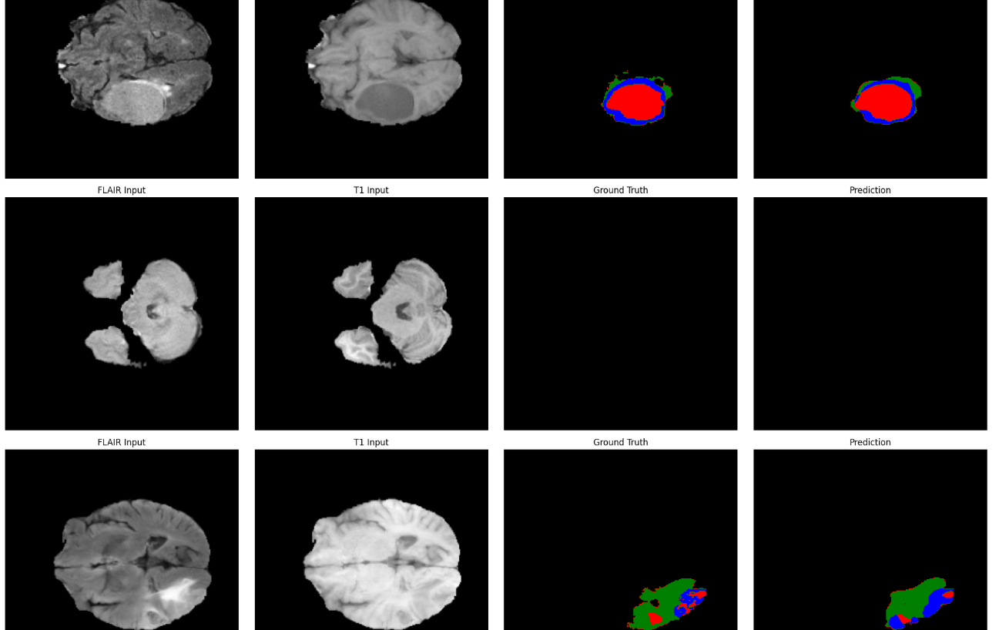
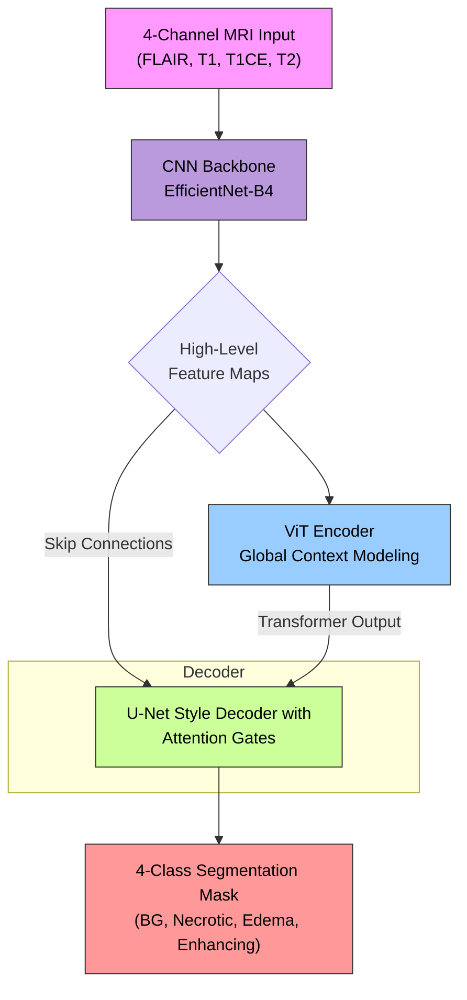

# TransUNet for Brain Tumor Segmentation on BraTS 2020

[](https://pytorch.org/get-started/locally/)
[](https://opensource.org/licenses/MIT)

This repository contains a PyTorch implementation of a **TransUNet-style hybrid vision transformer** for multi-class brain tumor segmentation on the BraTS 2020 dataset. The model leverages a CNN backbone for feature extraction and a transformer encoder for global context modeling, achieving a **0.825 Mean Dice Score** on the validation set.



## Performance

The model achieves strong performance across all three tumor sub-regions, with particularly precise segmentation of the Tumor Core (TC).

| Metric   | Enhancing Tumor (ET) | Tumor Core (TC) | Whole Tumor (WT) | **Average** |
| :------- | :------------------: | :-------------: | :--------------: | :---------: |
| **Dice** |        0.8256        |   **0.8444**    |      0.8053      |   0.8251    |
| **IoU**  |        0.7747        |   **0.8043**    |      0.7458      |   0.7749    |
| **HD95** |         6.22         |    **5.93**     |       7.70       |    6.61     |

- **Best Performing Region (Dice):** Tumor Core (TC) at **0.8444**
- **Most Precise Boundaries (HD95):** Tumor Core (TC) at **5.93mm**

### How these numbers were measured

- BraTS 2020 training set, split 90/10 by patient: 330 patients for training and 38 for validation, listed in `splits/validation_patients.txt`.
- Validation used every slice with tumor plus a random 25% of the tumor-free slices of those 38 patients (3,333 slices).
- Training ran 71 epochs with early stopping. The best checkpoint (epoch 56) was chosen on the same 38 patients; there is no separate test set.
- Dice and IoU are computed per 2D slice and averaged. A slice where the prediction and the ground truth are both empty counts as 1.0. HD95 is averaged over slices where both contain the region.
- These are internal validation numbers, so they aren't comparable to the official BraTS leaderboard, which scores whole 3D volumes.

## Key Features

- **Hybrid Architecture**: Combines a pre-trained **EfficientNet-B4** CNN backbone with a **Vision Transformer (ViT)** to capture both local and global dependencies.
- **Advanced Training**: Implements mixed-precision training (FP16), gradient accumulation, gradient clipping, and a `CosineAnnealingWarmRestarts` learning rate scheduler.
- **Robust Loss Function**: Utilizes a custom `DiceFocalLoss` to effectively handle the severe class imbalance inherent in the BraTS dataset.
- **Efficient Data Handling**: Features a highly optimized `Dataset` class with patient-level caching and a `PatientSampler` to minimize I/O bottlenecks during training.
- **Reproducibility**: All hyperparameters are centralized in `config/config.py` and can be overridden via command-line arguments. The validation patients are fixed in `splits/validation_patients.txt`.
- **Comprehensive Evaluation**: Includes utilities for calculating standard segmentation metrics (Dice, IoU) and specialized BraTS metrics (HD95 for ET, TC, and WT regions).

## Quick Start

### 1. Prerequisites

- Python 3.10 (3.9 to 3.11 also work; PyTorch 2.1.2 has no builds for 3.12 or newer)
- NVIDIA GPU with CUDA 11.8+ support
- BraTS 2020 Training Dataset ([Request Access](https://www.med.upenn.edu/cbica/brats2020/registration.html))

### 2. Installation

```bash
# Clone the repository
git clone https://github.com/AshutoshBhate/TransUNet_BraTs2020.git
cd TransUNet_BraTs2020

# Create and activate a conda environment
conda env create -f environment.yaml
conda activate brats_segmentation
```

### 3. Dataset Setup

Download the BraTS 2020 training data and organize it as follows. The script will automatically find the patient folders inside the `MICCAI_BraTS2020_TrainingData` directory.

```
/path/to/your/data/
└── MICCAI_BraTS2020_TrainingData/
    ├── BraTS20_Training_001/
    │   ├── BraTS20_Training_001_flair.nii.gz
    │   ├── ...
    │   └── BraTS20_Training_001_seg.nii.gz
    └── BraTS20_Training_002/
    └── ...
```

### 4. Training the Model

Point the main training script to your dataset path to begin.

```bash
python train.py --data_path /path/to/your/data/MICCAI_BraTS2020_TrainingData
```

## Architecture Overview

The model fuses a CNN encoder with a Transformer to generate rich feature representations for a U-Net style decoder.



## Technical Highlights

### Key Components

- **Hybrid Encoder**: An EfficientNet-B4 backbone, modified to accept 4-channel MRI input, extracts hierarchical features. The highest-level feature map is then fed into a ViT-Base model with dynamically interpolated positional embeddings to learn global relationships.
- **Attention-based Decoder**: The decoder reconstructs the segmentation mask by fusing multi-scale features from the encoder's skip connections. Attention Gates are used to filter these skip connections, allowing the model to focus on the most relevant spatial information at each stage of upsampling.

### Adaptive Class Weighting & Loss

To combat extreme class imbalance, the model uses a sophisticated weighting scheme and a composite loss function.

```python
# Each class gets one weight from its overall pixel frequency, how many slices
# it appears in, and a border factor: 1.5 × (its pixels ÷ its border pixels).
weights = compute_enhanced_class_weights(train_dataset)

# The loss function combines Dice and Focal loss to balance
# overlap-based and hard-example-mining objectives.
criterion = DiceFocalLoss(class_weights=weights)
```

## License

This project is licensed under the MIT License - see the `LICENSE` file for details.

## Paper

The method and results are described in:

> Ashutosh Bhate and Mousami Turuk, "Optimized 2D Hybrid CNN-Transformer Architecture for Multi-Modal Brain Tumor Segmentation," accepted at ICTCS 2026.

If you use this code in your research, please cite the paper.
